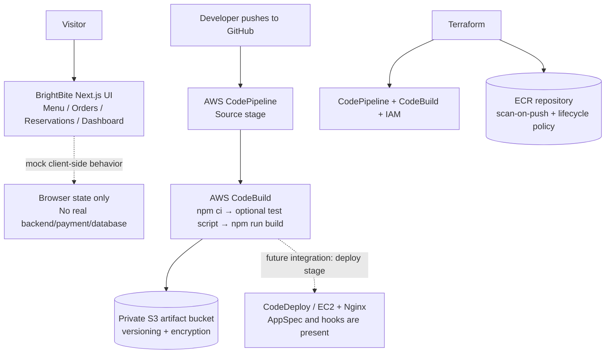
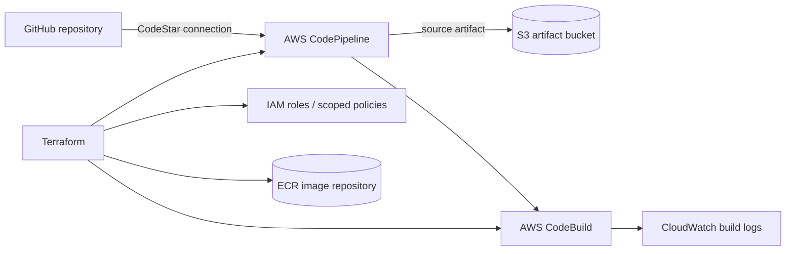

<div align="center">


  

</div>

---

# BrightBite — AWS SDLC Automation Project

BrightBite is a colorful Next.js restaurant ordering/management **front-end demo** paired with an AWS infrastructure-as-code exercise. The UI includes menu, reservation, order and dashboard screens; these are mock/browser-side interactions, not a connected payment or production backend.

   

[**Source code**](https://github.com/AhmedRaza92110/ecommerceApp-devops-project) · [Terraform](infrastructure/terraform/) · [Build specification](buildspec.yml) · [Deployment specification](appspec.yml)

## 🏛️ Application and delivery architecture



**Important accuracy note:** Terraform currently defines a CodePipeline Source stage and BuildAndTest stage, a private/versioned/encrypted S3 artifact bucket, an ECR repository, and IAM roles. The repository also has an AppSpec file for Nginx/EC2 deployment, but a CodeDeploy stage and the referenced hook scripts need to be completed and wired into the pipeline before this is an automatic end-to-end deployment. The ECR resource is currently prepared for a future image workflow; the current buildspec does not build or push a Docker image.

## ☁️ Infrastructure map



## 💡 Why choose these services?

| Choice | Engineering rationale |
|---|---|
| Terraform | Makes cloud resources reviewable, repeatable and easier to destroy/recreate for learning |
| CodePipeline | Coordinates source and build stages as a managed workflow |
| CodeBuild | Runs dependency installation, optional tests and the production build in a managed environment |
| S3 artifact bucket | Stores pipeline artifacts separately from compute; versioning and encryption are enabled in Terraform |
| ECR | Provides a private AWS-native registry for a future container-based release stage |
| IAM roles | Lets AWS services assume task-specific roles instead of embedding access keys in source code |
| CloudWatch Logs | Gives a place to inspect CodeBuild execution logs |
| AppSpec + Nginx hooks | Establishes the intended EC2 static-site deployment contract, once the deployment stage/scripts are finished |

## ▶️ Run the app locally

Prerequisites: Node.js 20+ and npm.

```bash
npm ci
npm run dev
```

Open `http://localhost:3000`. To validate the production build:

```bash
npm run build
```

Check `next.config.mjs` and the build output before assuming the site export path expected by `appspec.yml` is generated in your environment.

## 🧰 Terraform setup

1. Install AWS CLI and Terraform; configure a least-privilege AWS identity.
2. Create/authorize the GitHub CodeStar connection in the AWS account.
3. Create a local `terraform.tfvars` file with `github_connection_arn`, `github_full_repository_id` and any intended overrides.
4. Run `terraform init`, `terraform fmt -check`, `terraform validate`, then inspect `terraform plan`.
5. Apply only after reviewing the resources and expected costs.

```bash
cd infrastructure/terraform
terraform init
terraform fmt -check
terraform validate
terraform plan
# terraform apply  # run only after reviewing the plan
```

## 📈 Recruiter-facing implementation roadmap

- [x] Terraform-managed artifact bucket, ECR, IAM, CodeBuild and CodePipeline Source/Build stages.
- [x] Buildspec for dependency installation, optional test script and Next.js production build.
- [ ] Add a real automated test suite and fail the build on lint/test errors.
- [ ] Complete the CodeDeploy/EC2 deployment stage and non-empty, idempotent Nginx lifecycle hooks.
- [ ] Confirm the build output path matches the AppSpec source directory.
- [ ] Add deployment validation, health checks and rollback behavior.
- [ ] Add a pipeline diagram/screenshot from a successful run and document the teardown process.

## 🔐 Cost and security notes

- This is a learning project; AWS resources can incur charges. Review the Terraform plan and destroy resources when finished.
- Do not commit AWS credentials, Terraform state, generated plans or secret values.
- Keep the artifact bucket private and use least-privilege IAM policies.
- Avoid publicly exposed administrative ports; use SSM Session Manager or tightly restricted SSH where compute access is needed.

> **Project scope:** BrightBite currently demonstrates a front-end UI and an AWS pipeline foundation. It is not a production e-commerce backend and does not process real payments or persist real orders.
